<p align="center">
  
</p>

# 🔐 Network Security Infrastructure Lab

> Implementación, seguridad, autenticación, monitoreo y hardening de una infraestructura de red empresarial (laboratorio).

<p align="center">
  
  
  
  
  
  
  
  
  
  
  
  
  
</p>

---

## 🎥 Demonstration

**Video completo del proyecto:**

[▶️ Ver demostración del proyecto](https://youtu.be/c5fdI4BFvHI)

---

## 📊 Resumen

| Componente | Estado | Nota |
|---|---|---|
| 🔐 RADIUS / NPS | ✅ Verificado | Configuración del router y de NPS/AD documentada. Login con usuario de AD y login local:  |
| 🛡️ VPN Cisco ↔ FortiGate | 🟡 Parcial | Configuración del router documentada. GUI FortiGate, túnel UP/DOWN y pings: `[PENDIENTE]` |
| 📡 SNMP (solo lectura) | ✅ Implementado | Lectura OK y `SET` rechazado (`noAccess`) |
| 🌐 DHCP | ✅ Implementado | Pool, exclusiones, binding y cliente |
| 🔑 SSH | ✅ Implementado | SSHv2, Telnet fuera de VTY, acceso a router y switch |
| 🧪 CIS Audit | ✅ Ejecutado | **47.8 %** (11 PASS / 12 FAIL), sin remediación aplicada |
| 📊 Zabbix | ✅ Implementado | R1 por SNMP, disponibilidad verde, 6 ítems con datos |
| 🖥️ LAN Connectivity | ✅ Verificado | Pings y `show ip interface brief` |

---

## 🌐 Network Topology

<p align="center">
  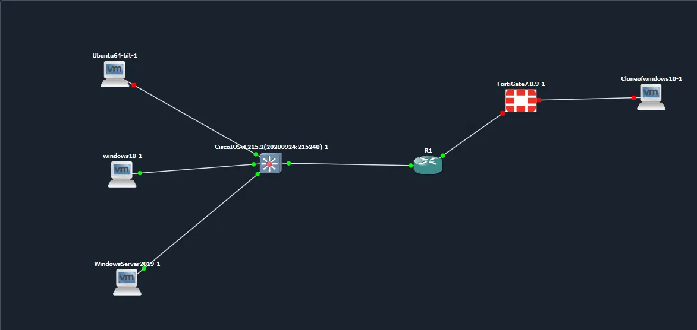
</p>

| Equipo | Rol |
|---|---|
| **R1-0697** (Cisco IOS) | Routing inter-VLAN, DHCP, cliente RADIUS, SNMP, SSH, extremo VPN |
| **SW1-0697** (Cisco IOSvL2 15.2) | Switching (VLAN 10/20), administración SSH |
| **Windows Server 2019** | Active Directory + NPS (RADIUS) |
| **Ubuntu 64-bit** (`zabbix-0697`) | Zabbix / SNMP |
| **FortiGate 7.0.9** | Extremo VPN IPsec (configurado por GUI) |
| **Windows 10** | Cliente de la LAN (DHCP) |
| **Windows 10 (clon)** | Host detrás del FortiGate |

---

# 🧪 Evidence

## 🔐 01 — RADIUS Authentication

```text
👤 Usuario
   │
   ▼
🖥️ Router Cisco (R1-0697)
   │  RADIUS  (UDP 1812/1813)
   ▼
🛡️ Windows NPS
   │
   ▼
📁 Active Directory (itla2025.local)
```

**Implementado:** `aaa new-model`, grupo `GRP-NPS` → servidor `NPS-0697`, método `group GRP-NPS local` en VTY (el usuario local `admin` es el respaldo) y `local` en consola. En NPS: cliente RADIUS `R1-0697`, directiva `Acceso-Admin-Cisco` (grupo `Admins-Red`) que entrega `Service-Type: Administrative` y `Cisco-AV-Pair shell:priv-lvl=15`.

<details>
<summary><b>Configuración del router (fragmento de <code>configs/R1/running-config.txt</code>)</b></summary>

```text
aaa new-model
aaa group server radius GRP-NPS
 server name NPS-0697
 ip radius source-interface GigabitEthernet1/0.20
aaa authentication login VTY-AUTH group GRP-NPS local
aaa authentication login CON-AUTH local
aaa authorization exec VTY-AUTHZ group GRP-NPS local
!
radius server NPS-0697
 address ipv4 20.25.97.10 auth-port 1812 acct-port 1813
 timeout 3
 retransmit 2
 key 7 [REDACTADO]
!
line vty 0 4
 authorization exec VTY-AUTHZ
 login authentication VTY-AUTH
 transport input ssh
```
</details>

| Active Directory | Roles del servidor |
|---|---|
| 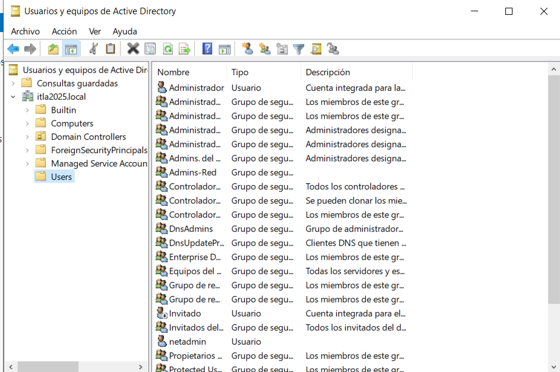 | 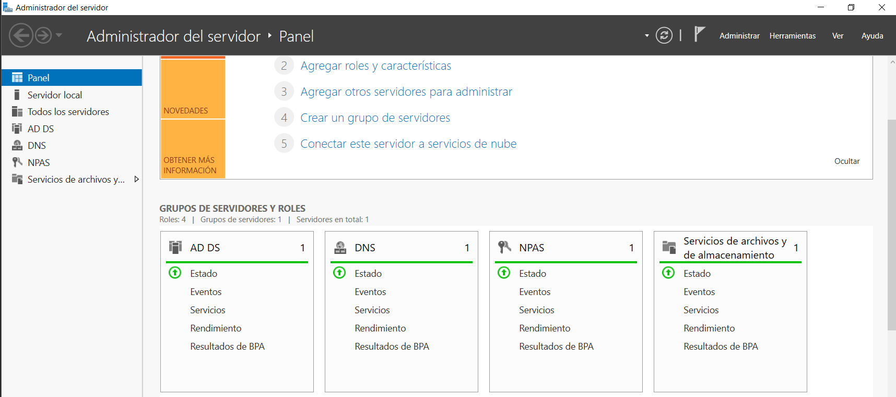 |

| Cliente RADIUS en NPS | Directivas de red |
|---|---|
| 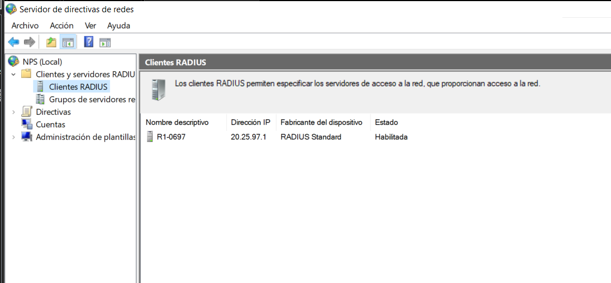 | 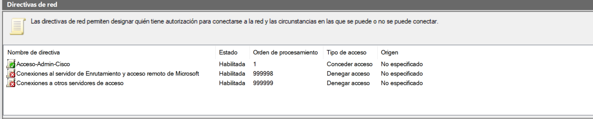 |

| Condición (grupo) | Atributo estándar | Atributo Cisco |
|---|---|---|
| 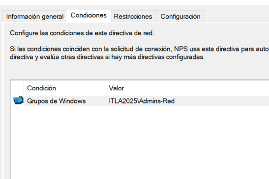 | 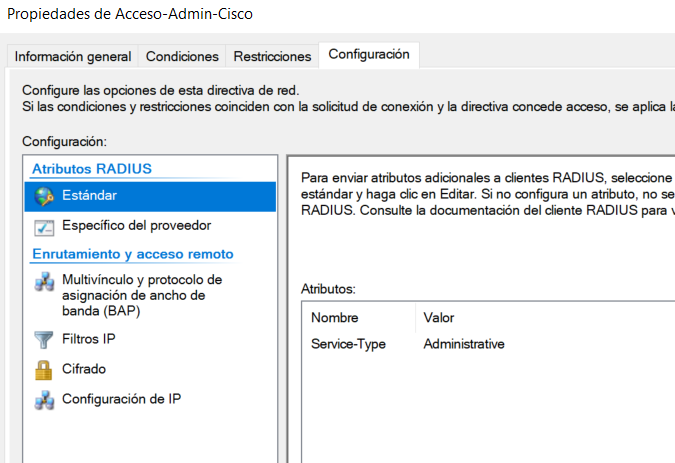 | 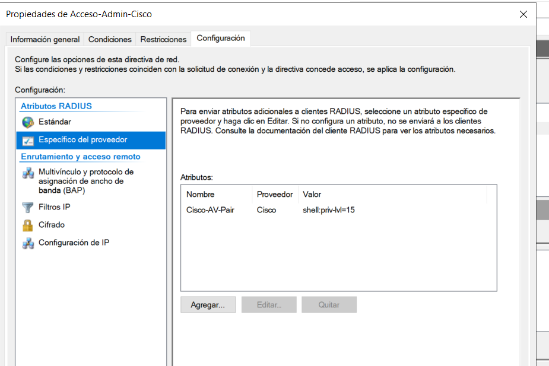 |

<p align="center">
  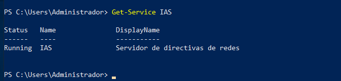<br>
  <sub>Servicio NPS (IAS) en ejecución · conectividad R1 → NPS:</sub><br>
  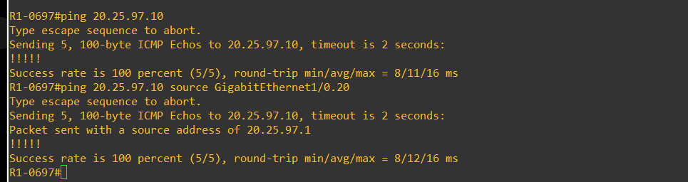
</p>

| Evidencia | Estado |
|---|---|
| Login exitoso con usuario de AD (`images/radius/login-radius.png`) | `[PENDIENTE]` |
| Login con usuario local / fallback (`images/radius/login-local.png`) | `[PENDIENTE]` |

---

## 🛡️ 02 — Cisco ↔ FortiGate VPN

Existe una VPN IPsec entre R1 (`20.25.69.1`) y el FortiGate (peer `20.25.69.2`) para el tráfico `20.25.6.0/24 ↔ 20.25.2.0/24`. El FortiGate se configura únicamente por GUI.

<details>
<summary><b>Configuración del router (fragmento)</b></summary>

```text
crypto isakmp policy 10
 encr aes 256
 hash sha256
 authentication pre-share
 group 14
 lifetime 28800
crypto isakmp key [REDACTADO] address 20.25.69.2
crypto ipsec transform-set TS-0697 esp-aes 256 esp-sha256-hmac
 mode tunnel
crypto map CMAP-0697 10 ipsec-isakmp
 set peer 20.25.69.2
 set transform-set TS-0697
 set pfs group14
 match address VPN-ACL
!
ip access-list extended VPN-ACL
 permit ip 20.25.6.0 0.0.0.255 20.25.2.0 0.0.0.255
!
interface GigabitEthernet2/0
 description WAN-HACIA-FORTIGATE
 ip address 20.25.69.1 255.255.255.252
 crypto map CMAP-0697
```
</details>

| Estado VPN | Comunicación |
|---|---|
| 🟢 UP | ✅ Permitida |
| 🔴 DOWN | ❌ No permitida |

| Evidencia | Estado |
|---|---|
| Configuración VPN en la GUI del FortiGate (`images/vpn/fortigate-vpn-config.png`) | `[PENDIENTE]` |
| Túnel UP en la GUI (`fortigate-tunnel-up.png`) | `[PENDIENTE]` |
| Config. del router (`router-vpn-config.png`) | Ver fragmento arriba; captura `[PENDIENTE]` |
| Ping con VPN activa (`ping-vpn-up.png`) | `[PENDIENTE]` |
| Ping fallido con VPN desactivada (`ping-vpn-down.png`) | `[PENDIENTE]` |

---

## 📁 03 — Repository Organization

```text
network-security-lab/
├── README.md
├── configs/        # running-config por equipo (secretos redactados)
│   ├── R1/  SW1/  FortiGate/
├── scripts/        # cis_hardening.py
├── reports/        # informe de la auditoría CIS
├── images/         # evidencias por requisito + animations/
│   ├── topology/ radius/ vpn/ snmp/ dhcp/ ssh/ hardening/ connectivity/ zabbix/
└── docs/           # evidencias.md (checklist y comandos)
```

---

## 📡 04 — SNMP Read Only

> La comunidad SNMP utilizada posee permisos de solo lectura (`RO`), por lo que las operaciones SET son rechazadas.

```text
snmp-server community <comunidad> RO SNMP-ACL
snmp-server location Santo-Domingo-Lab
snmp-server contact admin@itla.local
ip access-list standard SNMP-ACL
 permit 20.25.97.20
```

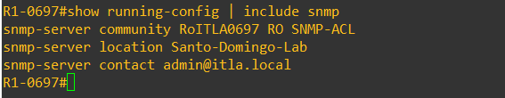

| `snmpwalk` (grupo system) | `snmpwalk` (OID sysName) |
|---|---|
| 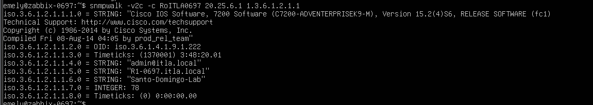 | 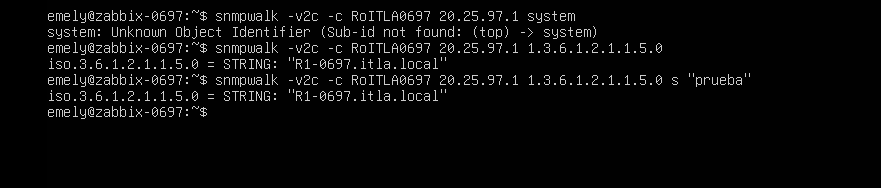 |

> En la captura de la derecha, el primer intento con el nombre simbólico `system` falla con *Unknown Object Identifier* (MIBs no instaladas en el servidor); se usaron OID numéricos.

| Resultado | Evidencia |
|---|---|
| **Escritura (`snmpset`) rechazada** — `Reason: noAccess` |  |
| `snmpget` | `[PENDIENTE]` (no se proporcionó captura) |

---

## 🌐 05 — DHCP

```text
ip dhcp excluded-address 20.25.6.1 20.25.6.10
ip dhcp pool LAN-0697
 network 20.25.6.0 255.255.255.0
 default-router 20.25.6.1
 dns-server 20.25.97.10
```

| `show running-config \| section dhcp` | `show ip dhcp pool` |
|---|---|
| 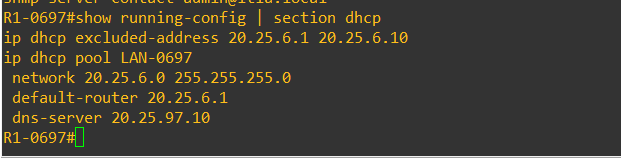 | 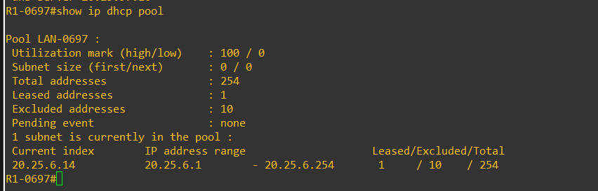 |

| `show ip dhcp binding` | `ipconfig` en el cliente |
|---|---|
| 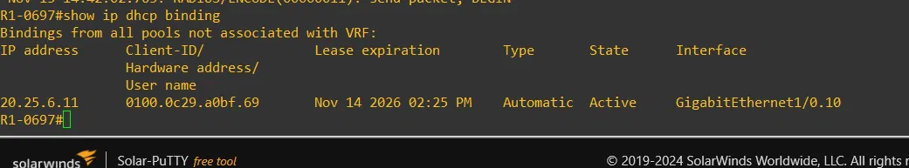 | 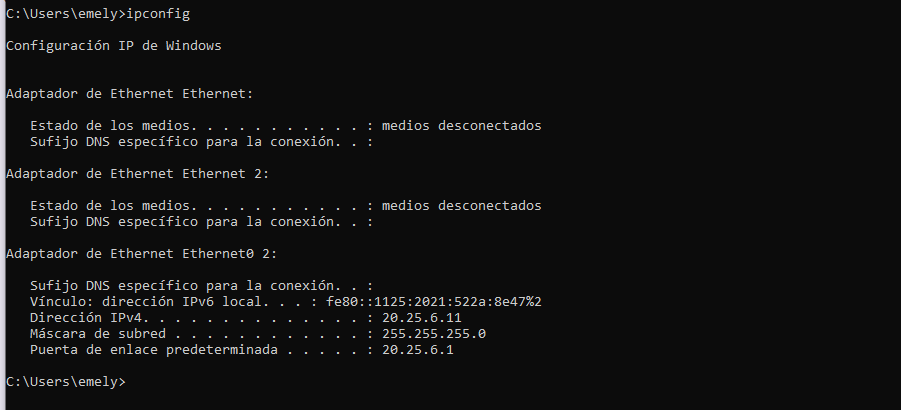 |

---

## 🧪 06 — CIS Hardening Audit

> El script realiza una auditoría de controles CIS seleccionados sobre el router y genera un informe de cumplimiento. El modo AUDIT no modifica la configuración del dispositivo.

```text
Python Script ──▶ Cisco Router ──▶ CIS Controls ──▶ Audit Report
```

**Resultado real (R1-0697):** `ANTES - cumplimiento: 47.8 %` → **11 PASS · 12 FAIL** (23 controles).

| PASS | FAIL |
|---|---|
| MGT-01, 03, 04, 05, 08, 10, 11, 12, 13, 14 · CTL-06 | MGT-02, 06, 07, 09, 15 · CTL-01, 02, 03, 04, 05 · DAT-01, 02 |

Informe: [`reports/cis-audit-report.txt`](reports/cis-audit-report.txt) · Script: [`scripts/cis_hardening.py`](scripts/cis_hardening.py)

```bash
python cis_hardening.py            # SSH al equipo (inventory.json)
python cis_hardening.py --offline ../configs/R1/running-config.txt:router
```

> 🔒 **Solo lectura:** el script únicamente envía `show running-config` al equipo (o lee un archivo con `--offline`). No tiene modo de remediación: los comandos correctivos aparecen en el informe como *recomendación* y no se aplican. Verificación: ejecutarlo sobre `configs/R1/running-config.txt` reproduce el 47.8 %.

Informes: [`txt`](reports/cis-audit-report.txt) · [`html`](reports/cis-audit-report.html)

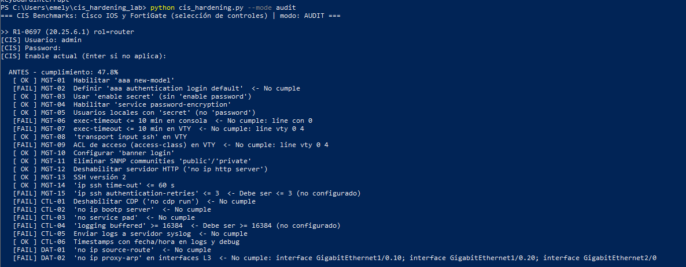

<details>
<summary><b>Comandos recomendados por el script (no aplicados)</b></summary>

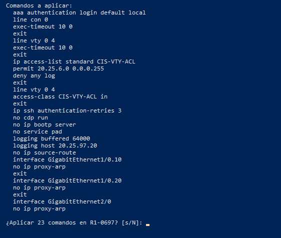
</details>

---

## 🔑 07 — Secure Remote Administration

| Servicio | Estado |
|---|---|
| SSH | ✅ Habilitado (versión 2, timeout 60 s, 3 reintentos) |
| Telnet | ❌ Deshabilitado (`transport input ssh` en VTY) |

Usuario local `admin` (privilegio 15) con `secret` (hash, redactado en el repositorio) y `service password-encryption`.

| Router — config SSH | Switch — config SSH |
|---|---|
| 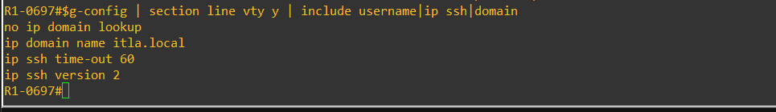 | 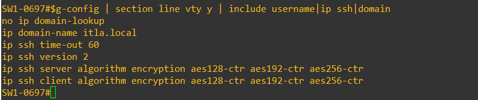 |

| Router — `show ip ssh` | Switch — `show ip ssh` |
|---|---|
| 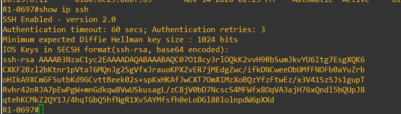 | 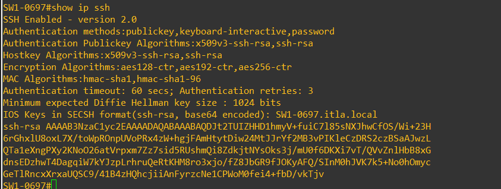 |

| Login SSH al router (`20.25.6.1`) | Login SSH al switch (`20.25.6.2`) |
|---|---|
| 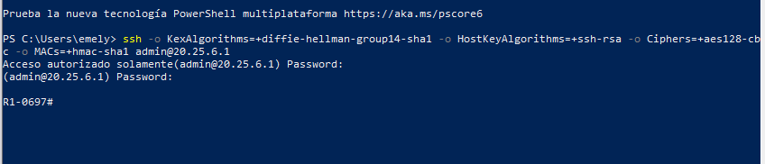 | 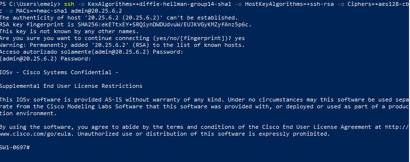 |

---

## 🌐 08 — Addressing & Connectivity

| Equipo | Hostname | IP | Función |
|---|---|---|---|
| Router | `R1-0697` | `20.25.6.1/24` (Gi1/0.10, VLAN 10) · `20.25.97.1/24` (Gi1/0.20, VLAN 20) · `20.25.69.1/30` (Gi2/0) | Routing / DHCP / RADIUS client / VPN |
| Switch | `SW1-0697` | `20.25.6.2/24` (Vlan10), gateway `20.25.6.1` | Switching |
| Windows Server | `[PENDIENTE]` | `20.25.97.10` | AD / NPS |
| Linux Server | `zabbix-0697` | `20.25.97.20` | Zabbix |
| PC (Windows 10) | `[PENDIENTE]` | `20.25.6.11` (DHCP) | Cliente |
| FortiGate | `[PENDIENTE]` | `20.25.69.2` (peer VPN según config. del router) | VPN |

| Router — `show ip interface brief` | Switch — `show ip interface brief` |
|---|---|
| 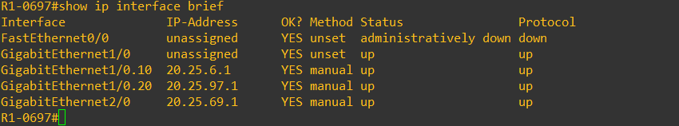 | 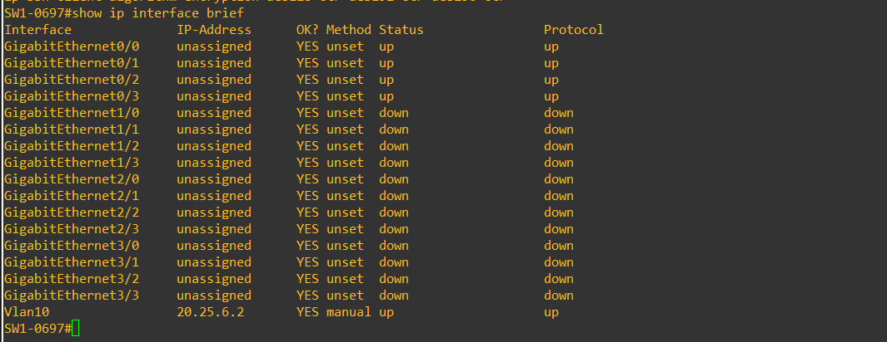 |

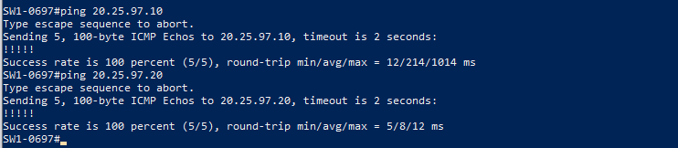

---

## ⚙️ Network Configurations

```text
R1
├── Hostname / dominio
├── AAA / RADIUS
├── Autenticación local
├── SSH
├── SNMP
├── DHCP
├── VPN (ISAKMP / IPsec)
└── Interfaces
```

| Equipo | Archivo |
|---|---|
| R1-0697 | [`configs/R1/running-config.txt`](configs/R1/running-config.txt) |
| SW1-0697 | [`configs/SW1/running-config.txt`](configs/SW1/running-config.txt) |
| FortiGate | [`configs/FortiGate/configuration.txt`](configs/FortiGate/configuration.txt) — `[PENDIENTE]` |

> En los archivos se redactaron los hashes `secret 5`, la clave RADIUS `key 7` y la clave precompartida IPsec.

---

## 📊 Monitoring — Zabbix

Zabbix 7.0.32 monitorea el R1 (`20.25.6.1:161`) con la plantilla *Cisco IOS by SNMP*; disponibilidad SNMP en verde.

| Equipos | Datos más recientes (R1) |
|---|---|
| 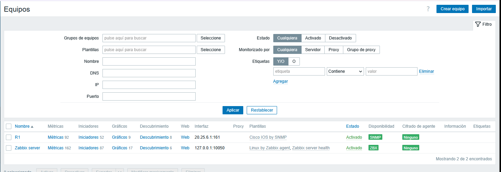 | 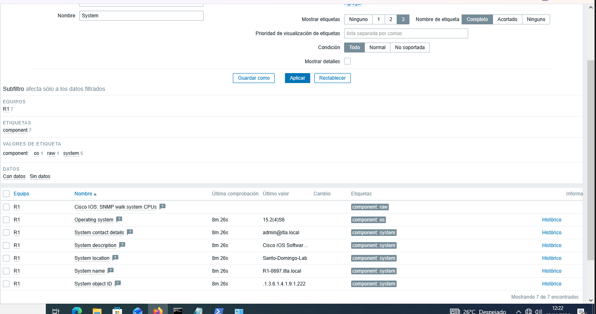 |

Ítems con datos: Operating system, System contact details, System description, System location, System name, System object ID. El ítem *SNMP walk system CPUs* no mostró valor.

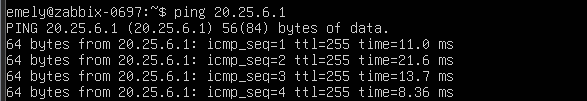

---

## ✅ Requirements Checklist

| # | Requisito | Evidencia | Estado |
|---|---|---|---|
| 01 | RADIUS + NPS | `images/radius/` | ⏳ Falta login AD y local |
| 02 | VPN Cisco ↔ FortiGate | `images/vpn/` | ⏳ Falta GUI FortiGate, túnel y pings |
| 03 | GitHub | Repository | ✅ |
| 04 | SNMP Read Only | `images/snmp/` | ✅ (`snmpget` pendiente) |
| 05 | DHCP | `images/dhcp/` | ✅ |
| 06 | CIS Audit | `reports/` | ✅ |
| 07 | SSH | `images/ssh/` | ✅ |
| 08 | Addressing | `images/connectivity/` | ✅ |
